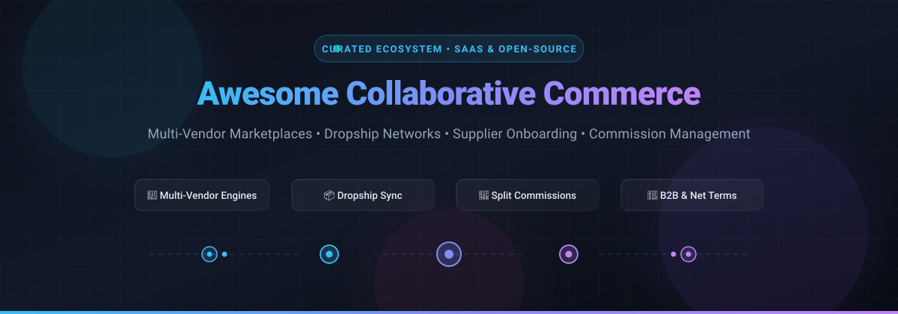

  

# 🛍️ Awesome Collaborative Commerce 🤝

  
  
  
  
  
  
  

  <strong>Curated ecosystem of SaaS products, distributed commerce frameworks, and open-source multi-vendor marketplace platforms.</strong> 
  <em>Engineered for brand cross-selling, dropship networks, supplier onboarding, automated split commissions, and B2B trade.</em>

---

## 📑 Table of Contents

- [🌟 Introduction & Key Concepts](#-introduction--key-concepts)
- [📊 Sector Overview & Market Dynamics](#-sector-overview--market-dynamics)
- [☁️ SaaS & Hosted Platforms](#️-saashosted-platforms)
- [💻 Open-Source GitHub Projects](#-open-source-github-projects)
- [🛠️ Architectural Trade-Offs: SaaS vs. Open Source](#️-architectural-trade-offs-saas-vs-open-source)
- [🤝 How to Contribute](#-how-to-contribute)
- [💖 Support](#-support)
- [📈 Star History](#-star-history)
- [⚖️ Disclaimer](#️-disclaimer)

---

## 🌟 Introduction & Key Concepts

**Collaborative Commerce** represents the shift from isolated storefronts to interconnected digital merchant networks. It allows brands, retailers, and suppliers to cross-sell each other's inventories, launch curated multi-vendor marketplaces, orchestrate automated dropshipping, and split commissions transparently—without holding excess physical inventory or custom-building complex payment routing from scratch.

### 🔑 Core Capabilities
- **Multi-Vendor Governance**: Streamlined vendor onboarding, catalog integration, KYC verification, and product approval pipelines.
- **Dropship & Inventory Synchronization**: Real-time two-way sync of stock availability, SKU mappings, and automated order fulfillment routing.
- **Automated Payouts & Commission Splitting**: Split transactions at checkout (via Stripe Connect, Adyen for Platforms, or ledger engines) with configurable take rates.
- **B2B & Net Terms**: Embedded trade credit, Buy Now Pay Later (BNPL) for corporate buyers, and accounts receivable (AR) automation.

---

## 📊 Sector Overview & Market Dynamics

The digital commerce and collaborative marketplace platform sector represents an estimated global market size of approximately **$9B to $16B** (expanding toward **$28B+** in specialized commerce cloud infrastructure, projected at a 12%–15% CAGR). 

The market is **moderately to highly fragmented** rather than winner-take-all, divided across enterprise digital commerce suites, specialized B2B dropship infrastructure engines, and composable open-source frameworks.

---

## ☁️ SaaS/Hosted Platforms

| Platform | Revenue / Valuation (Scale) | Starting Pricing | Free Tier / Free Trial Limits | Focus & Best For |
| :--- | :--- | :--- | :--- | :--- |
| **[Shopify Collective](https://www.shopify.com/collective)** | Market Cap: ~$125B+ (Shopify Inc.) / ~$8B+ Ann. Rev | Free add-on on standard plans (Shopify plans start at $39/mo billed monthly or $29/mo annually; standard transaction fees apply) | 3-day free trial on Shopify (followed by $1/mo promo for first 3 months); Collective itself has no additional subscription fee, but live checkouts require an active paid Shopify plan | Curated product exchange for Shopify merchants enabling cross-selling with inventory sync and automated order routing without holding inventory. |
| **[Mirakl](https://www.mirakl.com/)** | Valuation: $3.5B (Series E) / $15B+ GMV processed | Starts at ~$7,500/mo ($90,000–$100,000+/year base license) + ~1%–4.5% GMV take rate | No free tier or self-serve trial; custom proof-of-concept (PoC) and sales-guided demos only | Enterprise-scale multi-vendor marketplace platform for tier-1 retailers and distributors managing high seller counts. |
| **[balance](https://www.getbalance.com/)** | Valuation: ~$365M (Series B) / Rev: ~$15M–$50M | Starts at ~$2,000/mo base SaaS subscription + per-transaction fees (typically 1.5%–3% on net terms/invoicing) | No free tier or self-serve trial; live sandbox environment and enterprise demo available upon sales qualification | B2B payment, automated invoice processing, and instant net terms/financing infrastructure for marketplaces and wholesale trade. |
| **[VTEX Marketplace](https://vtex.com/)** | Market Cap: ~$650M (NYSE: VTEX) / Rev: ~$240.5M (FY2025) | Starts at ~$1,500–$2,000/mo base enterprise subscription + 1%–3% GMV variable success fee | No free tier or self-serve trial; demo and sandbox testing environments provided during enterprise sales scoping | Native enterprise marketplace engine embedded inside VTEX composable digital commerce suite. |
| **[Tradera](https://www.tradera.com/)** | Valuation: ~SEK 915M (~$85M) / Rev: ~€56.7M (~SEK 650M+) | Private sellers: 10% commission per sold item (min SEK 3, max SEK 200). Business stores: 0 SEK/mo (8% commission) or store plans from SEK 275/mo | Private sellers get 100 free listings/month (SEK 3–10 fee per unsold listing applied from 101st listing onwards); businesses get 500 free listings on basic tier | Nordic circular economy and consumer/B2B marketplace for second-hand, overstock, and new goods. |
| **[Marketplacer](https://marketplacer.com/)** | Funding: ~$85M–$100M total raised (Series C) / Est. Rev: ~$20M+ | Starts at ~$3,500–$5,000/mo (~$40,000–$60,000/year base SaaS license) + volume/take rate and implementation fees | No free tier or self-serve trial; guided software demonstrations and pilot scoping upon consultation | Scalable multi-vendor marketplace engine with catalog management and dropship connectivity for mid-to-large enterprises. |
| **[Convictional](https://www.convictional.com/)** | Funding: ~$49M (Series B) / Est. Rev: ~$8M–$12M | Starts at ~$2,000/mo base subscription fee + tiered transaction/order processing fees | No free tier or self-serve trial; custom enterprise pilot program and guided demonstrations only | Enterprise supplier enablement, automated dropship, and marketplace integration for omnichannel retailers. |
| **[Nautical Commerce](https://www.nauticalcommerce.com/)** | Funding: ~$32.2M (Series A, acquired by Traide) / Est. Rev: ~$4M+ | Starts at ~$1,500–$2,500/mo base platform license + transaction fees based on GMV | No free tier or self-serve trial; product demonstrations and sandbox evaluation upon request | Marketplace-as-a-service platform managing vendor onboarding, split checkout, and distributed catalog routing. |
| **[Canal](https://www.canal.com/)** | Funding / Valuation: Acquired by Rokt (July 2025; prior ARR ~$5.8M) | Starter: $0/mo install fee + 5% transaction fee on marketplace sales; Enterprise custom contract | Free plan available (Starter tier with $0 monthly platform fee, limited to 5% per-transaction fee on sales) | Collaborative commerce network allowing DTC brands and retailers to cross-sell products without inventory risk. |
| **[TradeRunner](https://www.traderunner.com/)** | Powered by Omnivore / City Beach Software (Est. Rev: ~$5M+) | Starts at $74.95/mo (Scale Up, up to $7,500/mo GMV) or 0.8% GMV (Pro tier, min $74.95/mo); Enterprise from $199.95/mo | Free plan available: $0/month for stores processing up to $1,000 USD in monthly sales revenue | Specialized marketplace integration connector syncing e-commerce stores (Shopify, WooCommerce, Magento) to Trade Me. |

---

## 💻 Open-Source GitHub Projects

The following repositories provide source-available foundations for building multi-vendor marketplaces, shared product catalogs, vendor portals, and split-order routing engines. Sorted by GitHub Stars_Count (descending):

1. ### 🚀 **[Medusa](https://github.com/medusajs/medusa)** 
   - **Description**: Composable digital commerce engine built with Node.js and TypeScript. With its modular architecture, Medusa powers customized B2B, multi-warehouse, and multi-tenant marketplace platforms (and serves as the underlying commerce backbone for purpose-built multi-vendor platforms like Mercur).
   - **Key Features**: Composable architecture, multi-warehouse support, automated workflows, extensive plugin ecosystem, Stripe and regional payment integrations.
   - **Tech Stack**: Node.js, TypeScript, PostgreSQL, Redis.
   - **License**: MIT.
   - **Best For**: Developers seeking an API-first, composable commerce core with complete source flexibility.

2. ### 🛒 **[Bagisto](https://github.com/bagisto/bagisto)** 
   - **Description**: Feature-rich Laravel-based eCommerce platform with an extensive dedicated **Multi-Vendor Marketplace** module.
   - **Key Features**: Dedicated vendor dashboard, product approval pipelines, configurable commission splits per vendor/category, multi-currency/multi-channel support, and POS integration.
   - **Tech Stack**: PHP, Laravel, Vue.js, MySQL.
   - **License**: MIT.
   - **Best For**: Teams in the PHP/Laravel ecosystem needing a batteries-included storefront and comprehensive multi-vendor marketplace out of the box.

3. ### ⚡ **[Saleor](https://github.com/saleor/saleor)** 
   - **Description**: High-performance headless GraphQL commerce platform built with Python and Django.
   - **Key Features**: Native multi-channel and multi-currency capabilities, webhook-driven app architecture for vendor synchronization, split fulfillment, and enterprise scalability.
   - **Tech Stack**: Python (Django), GraphQL, PostgreSQL, Next.js / React.
   - **License**: BSD-3-Clause.
   - **Best For**: Enterprise teams seeking a high-throughput, headless GraphQL infrastructure to orchestrate collaborative multi-channel commerce.

4. ### 💎 **[Spree Commerce](https://github.com/spree/spree)** 
   - **Description**: Battle-tested open-source eCommerce framework with a native marketplace extension, proven at scale by major multi-vendor retailers (e.g., Maisonette with 65,000+ SKUs).
   - **Key Features**: Vendor onboarding workflows, vendor self-service catalog management, split-shipment routing, configurable commission tiers per product or merchant, and enterprise upgrade path for Stripe Connect & Adyen payouts.
   - **Tech Stack**: Ruby on Rails, PostgreSQL, Docker.
   - **License**: AGPL-3.0 (Community Edition).
   - **Best For**: Ruby developers wanting a battle-proven multi-vendor foundation with rich vendor governance.

5. ### 🛡️ **[Solidus](https://github.com/solidusio/solidus)** 
   - **Description**: Composable, enterprise-grade digital commerce engine built on Ruby on Rails (forked from Spree and optimized for stability and deep customization).
   - **Key Features**: Highly modular architecture, marketplace extension support (`solidus_marketplace`), split fulfillment management, and multi-warehouse order distribution.
   - **Tech Stack**: Ruby on Rails, PostgreSQL.
   - **License**: BSD-3-Clause.
   - **Best For**: High-volume brands requiring fine-grained control over inventory routing, split order processing, and payment flows.

6. ### 👥 **[Sharetribe](https://github.com/sharetribe/sharetribe)** 
   - **Description**: Pioneer open-source marketplace software for peer-to-peer (P2P), rental, service, and product marketplaces.
   - **Key Features**: User profiles, listing management, integrated messaging, built-in transaction workflows, and booking/availability calendars.
   - **Tech Stack**: Ruby on Rails, MySQL.
   - **License**: Custom source-available / Community Edition (legacy Sharetribe Go).
   - **Best For**: Launching community marketplaces, peer-to-peer exchanges, and equipment or service rental networks.

7. ### 🐍 **[Shuup](https://github.com/shuup/shuup)** 
   - **Description**: Versatile open-source multi-vendor marketplace platform built on Django and Python.
   - **Key Features**: Native vendor onboarding, multi-vendor product catalogs, configurable commission rates, vendor management portal, and extensible pricing mechanisms.
   - **Tech Stack**: Python, Django, PostgreSQL.
   - **License**: OSL-3.0.
   - **Best For**: Python and Django engineers needing a complete multi-vendor marketplace engine with native vendor portals and catalog moderation.

8. ### 🪽 **[Mercur](https://github.com/mercurjs/mercur)** 
   - **Description**: Dedicated open-source multi-vendor marketplace engine purpose-built on Medusa for collaborative commerce.
   - **Key Features**: Master product catalog with multiple vendor offers, policy-based commission engine, automated vendor payouts via **Stripe Connect**, role-based vendor dashboards, and auditable approval workflows.
   - **Tech Stack**: Node.js, TypeScript, Medusa, PostgreSQL, Stripe Connect.
   - **License**: Source-available / Community.
   - **Best For**: Teams seeking a modern, purpose-built collaborative marketplace engine with built-in automated seller payouts and Medusa compatibility.

9. ### 🌐 **[GrandNode](https://github.com/grandnode/grandnode2)** 
   - **Description**: Cross-platform open-source eCommerce platform developed on .NET Core with NoSQL (MongoDB) database architecture.
   - **Key Features**: Native support for Multi-Vendor, Multi-Store, and Multi-Tenant business models, vendor performance metrics, and configurable commission structures.
   - **Tech Stack**: C# (.NET Core), MongoDB / Azure CosmosDB / DocumentDB.
   - **License**: GPL-3.0.
   - **Best For**: .NET enterprises and developers wanting high-concurrency multi-vendor marketplace software built on top of a NoSQL database.

10. ### 📦 **[Liberu Ecommerce](https://github.com/liberusoftware/ecommerce-laravel)** 
    - **Description**: Modern full-stack Laravel commerce framework designed with multi-vendor and dropshipping models in mind.
    - **Key Features**: Reactive checkout powered by Livewire, Stripe/PayPal integrations, DropXL dropshipping module, and wholesale B2B pricing tiers.
    - **Tech Stack**: PHP 8.5+, Laravel 13, Filament 5, Livewire 4.
    - **License**: MIT.
    - **Best For**: Modern Laravel developers looking for a lightweight, Filament-powered admin and reactive storefront ready for dropship and multi-vendor expansion.

---

### 📦 Additional Modules & Procurement Systems

- **[flexcommerce-marketplace](https://pypi.org/project/flexcommerce-marketplace/)**: Composable Django REST Framework module providing vendor onboarding, order splitting, KYC handling, and post-hold commission payouts.
- **VendorBridge AI**: AI-assisted ERP and procurement vendor portal for RFQ tracking, quotation comparisons, and PO approvals. *(Internal procurement focus).*
- **SevenSquare Vendor Management**: Laravel and Electron supplier tracking tool for vendor profiles, SLAs, and order auditing. *(Internal procurement focus).*

---

## 🛠️ Architectural Trade-Offs: SaaS vs. Open Source

| Dimension | Managed SaaS (e.g. Mirakl, Canal, Collective) | Open-Source Engine (e.g. Mercur, Bagisto, Spree) |
| :--- | :--- | :--- |
| **Vendor Onboarding** | Pre-built vendor portals & supplier network discovery | Customizable portal; self-hosted vendor registration workflows |
| **Split Payouts** | Fully managed merchant-of-record (MoR) or automated split payouts | Requires configuring Stripe Connect / Adyen for Platforms |
| **Infrastructure** | Fully managed, zero maintenance overhead | You operate host servers, databases, security compliance, & upgrades |
| **Pricing Model** | High monthly base ($1k–$8k+) + 1%–5% GMV take rate | 100% free / open license; zero recurring GMV platform take rates |
| **Data Ownership** | Vendor data stored within vendor cloud | 100% self-hosted ownership over customer, product, and vendor records |

---

## 🤝 How to Contribute

Contributions are warmly welcomed! Help keep this collaborative commerce guide comprehensive, accurate, and up-to-date:

1. 🍴 **Fork the repository**.
2. 🌿 **Create a feature branch**: `git checkout -b feature/new-commerce-tool`.
3. ✏️ **Add your project** in the appropriate section with:
   - Name and link to official website or GitHub repo.
   - Objective summary (1–2 sentences).
   - Tech stack, license, and primary use case.
4. 📬 **Submit a Pull Request** with a brief summary of why the tool is a good fit.

---

## 💖 Support

If you found this curated list helpful for building or researching collaborative commerce architectures:

- 🌟 **Star this repository** to help others discover it!
- 🍴 **Fork it** to maintain your personal reference or contribute new features.
- 📢 **Share it** on LinkedIn, X/Twitter, or developer communities.
- ☕ **Support the maintainer**: Buy a coffee and support open-source curation via the [GitHub Sponsor Dashboard](https://github.com/sponsors/ishandutta2007)!

---

## 📈 Star History

---

## ⚖️ Disclaimer

- This repository is a **community-curated directory** intended for informational and educational purposes; inclusion does not constitute an endorsement.
- Multi-vendor and collaborative commerce applications involve handling third-party funds, customer data, and tax remittances. Implementers are solely responsible for ensuring compliance with GDPR, CCPA, PCI DSS, marketplace sales tax regulations, and payment provider platform agreements.
